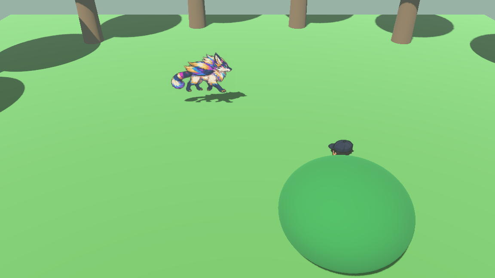
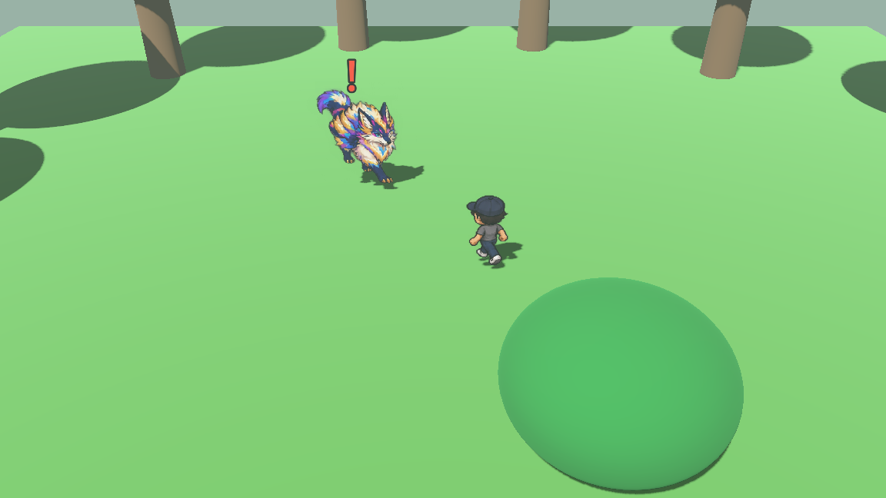
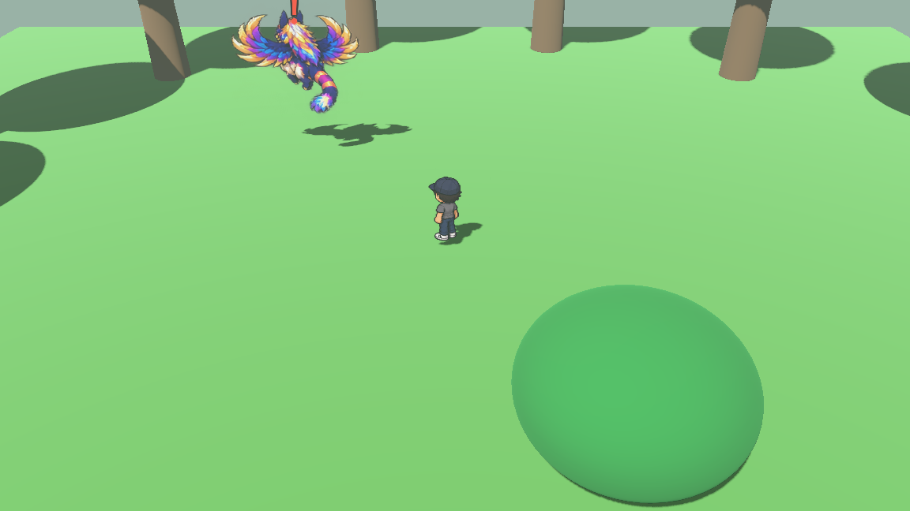

# FAUN-WORLD

RPG de criaturas inspirado em Pokémon e Dragon Quest, feito em Godot 4.7, com mundo 3D e personagens 2D (estilo HD-2D).

**Jogar no navegador:** https://gabrielcamargols.github.io/FAUN-WORLD/

## Controles

- Setas ou WASD: andar

## Cena atual: a clareira

O menino está escondido atrás de uma moita. Quando ele se aproxima, Brasatã percebe, se assusta e foge voando.

| Início | Brasatã assustado | Brasatã voando |
|---|---|---|
|  |  |  |
